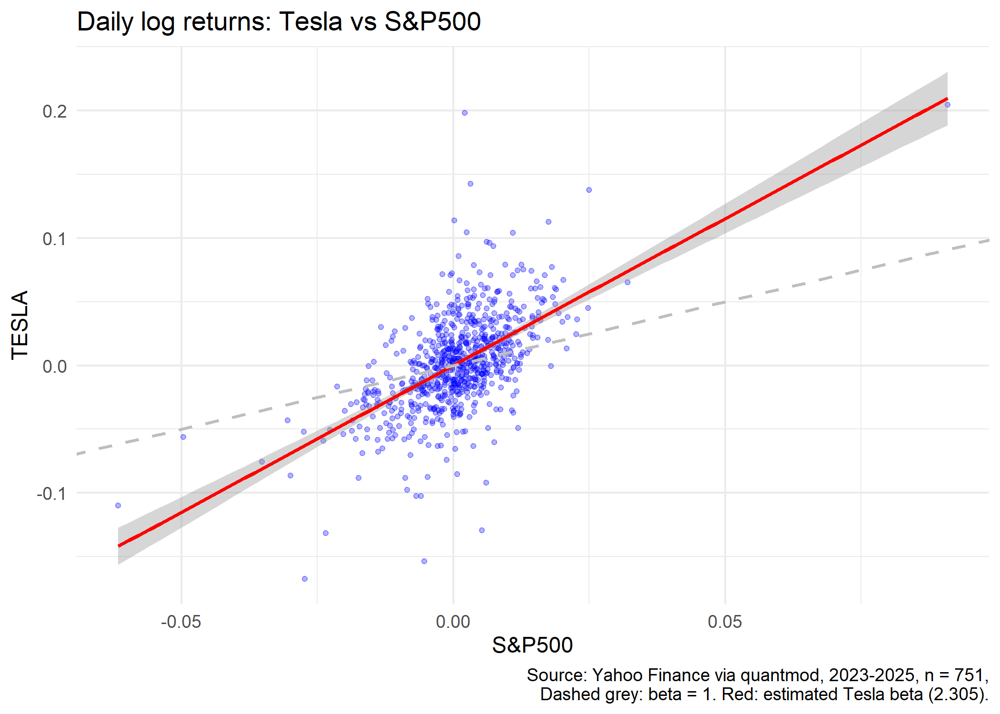
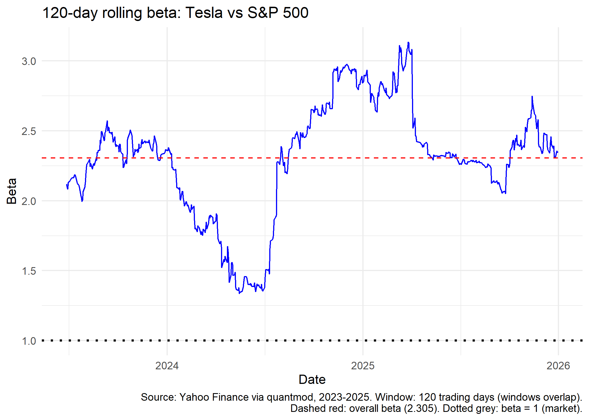
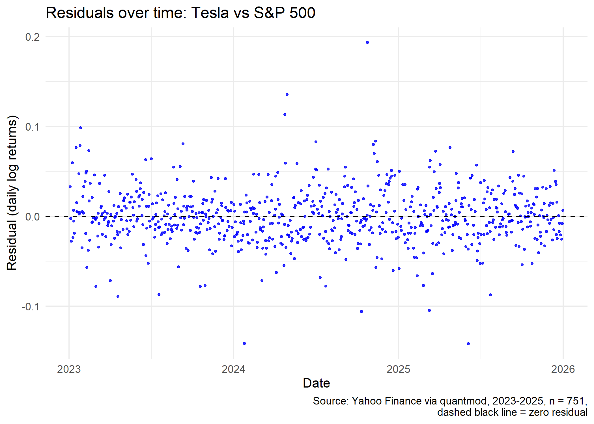
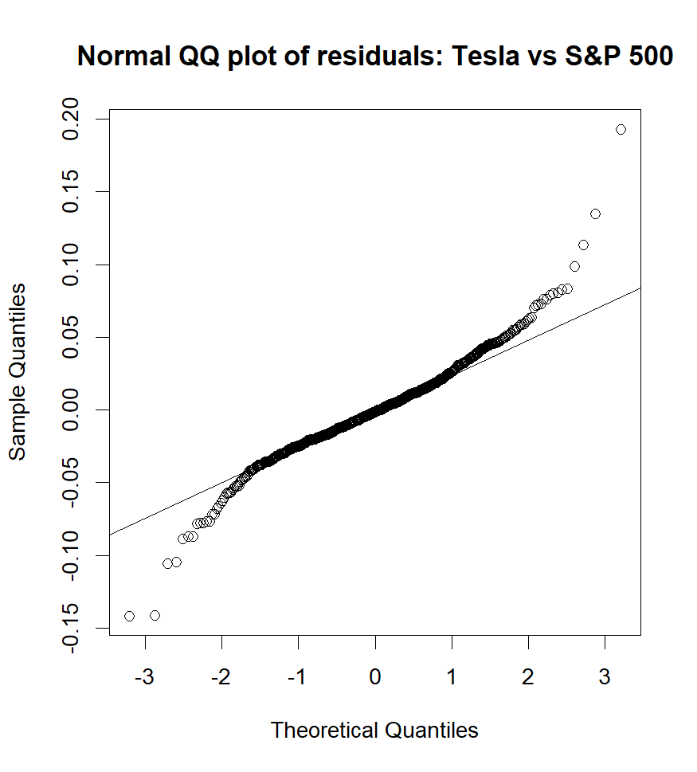

# Beta of Tesla relative to the S&P 500

The first part of the project estimates the beta of Tesla (TSLA) relative to the S&P 500 using daily log returns from 2023 to 2025. The analysis is done in R.

## Data

- Source: Yahoo Finance, downloaded with the `quantmod` package on 5 October 2026
- Period: January 2023 to December 2025
- Observations: 751 daily log returns, computed from adjusted close prices
- The first observation was removed because a return is not defined for it
- Data files (in data folder): `data/tesla_sp500.csv` and `data/tesla_sp500.rds`

The CSV file contains the date, daily log returns of Tesla and daily log returns of S&P 500 in this order.

## Method

Beta is estimated with a simple linear regression of Tesla returns on S&P 500 returns:

`tesla = alpha + beta * sp500 + error`

- `alpha` is the intercept: the average Tesla return on a day when the S&P 500 return is zero.
- `beta` is the slope: how much the Tesla return changes on average when the S&P 500 return changes by one unit.
- `error` is the part of the Tesla return that the market does not explain.

## Results

- Beta: 2.305 (standard error 0.118, 95% confidence interval 2.07 to 2.54)
- Alpha: 0.0001 (not statistically significant, p = 0.92)
- R-squared: 0.34

The dashed grey line has a slope of 1 (the market). The red line is the estimated regression line for Tesla.

## Conclusion

Tesla amplifies market movements: when the S&P 500 moves by 1%, Tesla moves by about 2.3% on average. However, the market explains only about one third of Tesla's daily return variation, the remaining two thirds are unexplained by the model and are largely driven by company-specific factors.

# Rolling beta

The beta in the previous section is a single number for the whole period. To see whether it is stable over time, I estimated it again in a moving window of 120 trading days (about six months). For each day, the regression of Tesla returns on S&P 500 returns uses only the previous 120 days. The window then moves forward by one day.

- Window: 120 trading days
- Number of estimates: 632 (the first 119 days have no value because the first window needs 120 observations)
- First value: 27 June 2023 (beta 2.12)
- Minimum: 1.34, maximum: 3.13, median: 2.34

The dashed red line is the overall beta (2.305). The dotted line is beta = 1, which is a stock that moves one-for-one with the market.

The rolling beta changes a lot over time. It is close to the overall value in the second half of 2023, falls to its lowest level in 2024, and rises above 3 in early 2025. It never falls below 1, suggesting that Tesla was more sensitive to market movements than the S&P 500 in every rolling window. This illustrates how a single beta estimate for the entire period can conceal substantial changes in Tesla's market sensitivity.

Two limitations should be considered. First, neighbouring windows overlap, meaning that consecutive beta estimates are not independent. This overlap can make the rolling beta series appear smoother than the underlying changes in the estimates might suggest. Second, sudden jumps can occur when an extreme daily observation enters or leaves the rolling window, such jumps do not necessarily indicate a genuine change in Tesla's underlying market sensitivity.

## Residual diagnostics

The regression results above rely on assumptions about the residuals (the part of Tesla's return that the market does not explain). I checked them with two plots, two statistical tests and a robust inference check. The code is in `diagnostics.R`, which reads `data/tesla_sp500.rds`.

The residuals are scattered around zero with no visible trend. Some days are far from zero (the largest is about +0.19), which are days when company-specific events moved Tesla much more than the market.

- Breusch-Pagan test (constant variance): BP = 0.10, p = 0.75
- Durbin-Watson test (autocorrelation): DW = 1.92, p = 0.13
- Robust (HC3) standard error of beta: 0.117, compared with the classical 0.118

The Breusch-Pagan test finds no evidence of heteroskedasticity, and the Durbin-Watson test finds no evidence of positive first-order autocorrelation. The robust standard error is almost identical to the classical one, so the confidence interval is practically unchanged and the conclusion does not depend on the constant-variance assumption. Note that a test that does not reject an assumption does not prove it. It only means that the data show no evidence against it.

The QQ plot shows that the residuals follow the normal distribution well in the centre, but both tails are heavier than normal. The beta estimate is not affected by this, but confidence intervals based on normality are only approximate. With 751 observations and almost identical robust standard errors, the conclusion that beta is clearly above 1 holds.

